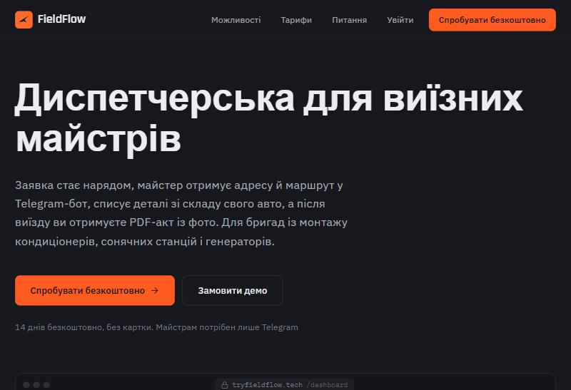
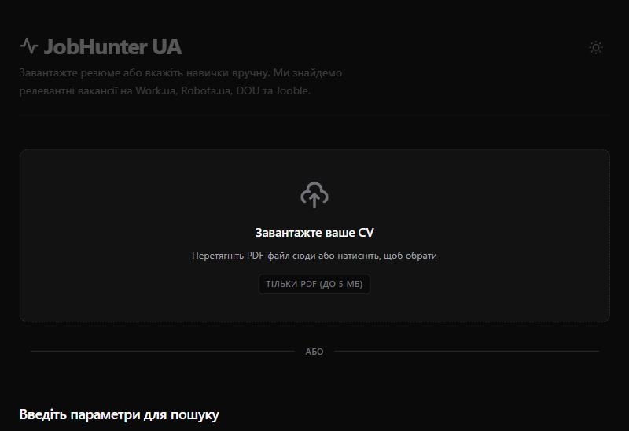

# Hi, I'm Vladyslav 👋

Software Engineering student at **Kyiv School of Economics** · building backend, agents and small tools

---

### About me

I'm a Software Engineering student focused mostly on backend and tooling: TypeScript/Node, Python and C#/.NET, with a C/C++ background from university coursework. Lately I've been building resilient API clients, an AI booking agent on Telegram, and a field-service SaaS product.

- 💼 Working as a **Web Developer at Luxeo**
- 🔭 Currently working on **[FieldFlow](https://tryfieldflow.tech/)** — a field-service management product, deployed and in use
- 🧪 Recently shipped **[resilient-api-client](https://github.com/VladyslavHryn/resilient-api-client)** — a fetch wrapper with timeouts, backoff and typed errors
- 🤖 Built an **[AI booking agent](https://github.com/VladyslavHryn/restaurant-booking-agent)** that runs a real conversation over Telegram
- 🎓 Studying Software Engineering at KSE

### Contact

---

### Projects

<table>
<tr>
<td width="50%">

<b><a href="https://tryfieldflow.tech/">FieldFlow</a></b> 
Dispatch/CRM for field-service crews (HVAC, solar, generators): a job becomes a work order, the technician gets the route in Telegram, and the client gets a PDF report with photos on completion. 
FastAPI · React · aiogram · deployed, in real use
</td>
<td width="50%">

<b><a href="https://github.com/VladyslavHryn/Trailback">Trailback</a></b> 
Turns a Google Takeout location export into an interactive map and life insights — entirely in the browser, nothing uploaded. 
TypeScript · runs client-side · <a href="https://trailback.hrynvladyslav07.workers.dev/">live demo</a>
</td>
</tr>
<tr>
<td width="50%">

<b><a href="https://github.com/VladyslavHryn/JobHunter-UA">JobHunter UA</a></b> 
Parses an uploaded resume and scores matching vacancies across Work.ua, Jooble, Robota.ua and DOU on a 100-point relevance scale. 
Python · React · <a href="https://jobhunter-frontend-fki6.onrender.com/">live demo</a>
</td>
<td width="50%">
<b><a href="https://github.com/VladyslavHryn/resilient-api-client">resilient-api-client</a></b> 
A fetch wrapper for a flaky external API: per-attempt timeout, exponential backoff, <code>Retry-After</code> handling, typed errors. No dependencies, fully tested. 
TypeScript (strict) · Vitest · zero deps
</td>
</tr>
<tr>
<td width="50%">
<b><a href="https://github.com/VladyslavHryn/restaurant-booking-agent">restaurant-booking-agent</a></b> 
An AI agent that books a restaurant table end-to-end by holding a real conversation in Telegram — starts the chat itself, never invents facts, recovers from its own mistakes, and repeats the confirmed booking back. 
Python · Telegram · own stress tests + decision log
</td>
<td width="50%">
<b><a href="https://github.com/VladyslavHryn/Crypto-Screener">Crypto-Screener</a></b> 
Full-stack screener that pulls live market data from CoinGecko, filters it server-side, and shows it in a searchable, sortable table. 
FastAPI · React + TypeScript (Vite)
</td>
</tr>
</table>

---

### Stack

---

### GitHub stats

